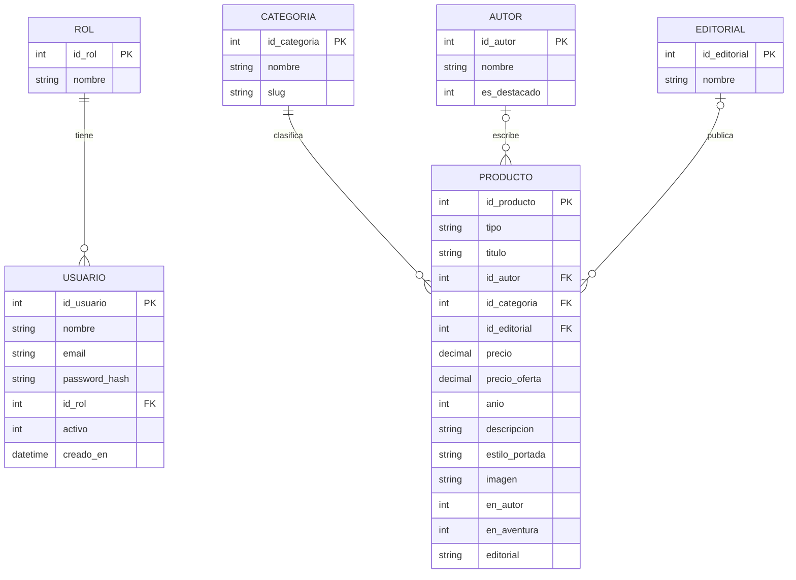

# Modelo Entidad-Relación — Practicos3MD

Biblioteca virtual del práctico 1. El modelo cubre el catálogo público (libros, revistas y audiolibros) y el ingreso con roles del práctico 2.

## Entidades

- **Rol.** Tipo de cuenta. En este práctico hay dos: administrador y usuario.
- **Usuario.** Persona que inicia sesión. Tiene un único rol.
- **Categoría.** Género o sección del catálogo (fantasía, terror, amor, aventura, clásicos, cultura, ciencia, drama).
- **Autor.** Persona asociada a un libro o a un audiolibro. Una revista puede no tener autor.
- **Editorial.** Sello que publica el título.
- **Producto.** Cada título del catálogo. El atributo `tipo` distingue libro, revista y audiolibro.

## Relaciones y cardinalidades

| Relación | Cardinalidad | Lectura |
| --- | --- | --- |
| Rol — Usuario | 1 a N | Un rol agrupa muchos usuarios. Cada usuario tiene exactamente un rol. |
| Categoría — Producto | 1 a N | Una categoría reúne muchos títulos. Cada título pertenece a una categoría. |
| Autor — Producto | 0..1 a N | Un autor puede firmar muchos títulos. Un título tiene un autor o ninguno (las revistas). |
| Editorial — Producto | 0..1 a N | Una editorial publica muchos títulos. Un título puede quedar sin editorial. |

## Claves primarias

Cada entidad tiene un identificador propio: `id_rol`, `id_usuario`, `id_categoria`, `id_autor`, `id_editorial` e `id_producto`.
